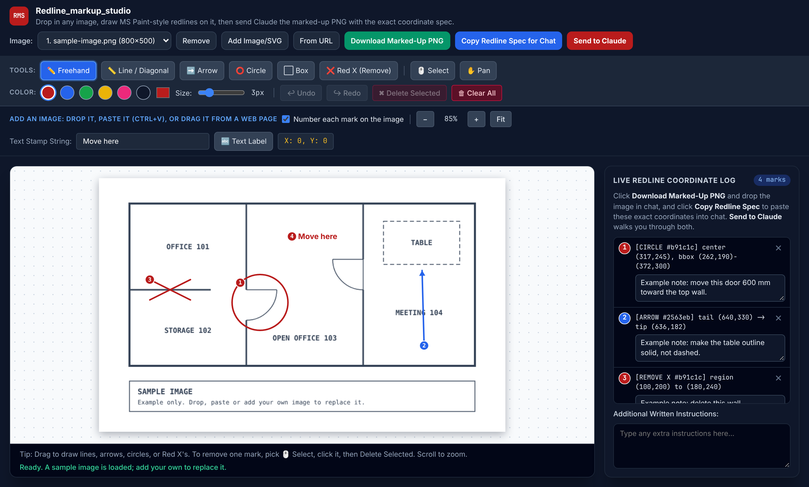

# Redline_markup_studio

Show Claude what to change instead of describing it. Drop in any image, draw redlines on it, and hand Claude the marked-up PNG together with an exact coordinate spec of every mark.

It is a Claude **plugin** that carries one **skill**. The same skill also uploads to claude.ai, and the studio itself is a single HTML file that works on its own.



## What you get

- **Any image in.** Drop a file from your computer, drag an image straight off a web page, paste with Ctrl+V, type a web address, or let Claude load an image it just made.
- **The original markup tools.** Freehand, Line / Diagonal, Arrow, Circle, Box, Red X (Remove) and Text Label, six colour swatches plus a custom colour, sizes 1-12, Undo, Redo and Clear All.
- **A live coordinate log.** Every mark gets a numbered line with exact pixel coordinates, and the same number is drawn as a badge on the image. Add a note to any mark to say what should change there.
- **One-click hand-off.** In Claude Code, **Send to Claude** saves the marked-up PNG, the clean original and the spec into your project and Claude picks them up. Anywhere else, copy or download the image and copy the spec into the chat.
- **Fix one mark without undoing the rest.** Pick Select, click any mark on the image (or its line in the log), then Delete Selected. Drag a selected mark to move it.
- **Extras.** Zoom and pan for large images, several images at once.
- **Private.** The studio loads nothing from the internet. In Claude Code the helper listens on `127.0.0.1` only and writes to `.redline_markup_studio/` inside your project (ignored by git).

## Install in Claude Code

Needs Node.js 18 or newer. In a Claude Code session:

```
/plugin marketplace add Hverdu86/markup-studio
/plugin install redline-markup-studio@markup-studio
```

Then just ask, for example "open the redline studio on docs/diagram.png", or run `/redline-markup-studio:redline-markup-studio`. Your browser opens the studio; mark up the image and press **Send to Claude**.

`redline-markup-studio` is the install id (plugin ids must be lowercase with hyphens); it shows up as **Redline_markup_studio**.

## Install on claude.ai and the Claude apps

1. Download [`dist/redline-markup-studio.zip`](dist/redline-markup-studio.zip).
2. In Claude, open **Customize > Skills**, upload the zip and switch the skill on. Code execution must be enabled.
3. In any chat or project, ask Claude to open the redline studio. Claude hands you the studio page; mark up your image there, press **Send to Claude**, and paste the image and the spec back into the chat.

Skills are added per account; on Team and Enterprise plans an owner can provision the skill for everyone.

## Use it with no install

Open [`skills/redline-markup-studio/assets/Redline_markup_studio.html`](skills/redline-markup-studio/assets/Redline_markup_studio.html) in a browser. Mark up an image, then attach the downloaded PNG and paste the copied spec into any Claude conversation.

## How the Claude Code link works

`skills/redline-markup-studio/scripts/redline_markup_studio.js` is a small dependency-free helper:

| Command | What it does |
| --- | --- |
| `open [--image PATH_OR_URL]...` | Starts the studio for the current project, queues images, opens the browser |
| `wait [--timeout SECONDS]` | Blocks until you press **Send to Claude**, then prints the spec and file paths |
| `latest` | Prints the most recent markup again |
| `status`, `stop` | Reports on, or shuts down, the helper |
| `bundle --out FILE.html [--image ...]` | Writes a standalone studio page with images preloaded |

Each send creates a folder under `.redline_markup_studio/submissions/` holding `image-N-annotated.png`, `image-N-original.*`, `redline-spec.md` and `markup.json`.

## What a redline spec looks like

```
Redline_markup_studio redline spec
Coordinates are image pixels (X right, Y down) from the top-left corner. Each number matches the numbered badge drawn on the marked-up image.

Image: floor-plan.png (800x500) - marked-up file: image-1-annotated.png
--- Redline Marks ---
1. [CIRCLE #b91c1c] center (317,245), bbox (262,190)-(372,300) - move this door 600 mm toward the top wall
2. [ARROW #2563eb] tail (640,330) -> tip (636,182) - make the table outline solid, not dashed
3. [REMOVE X #b91c1c] region (100,200) to (180,240) - delete this wall
4. [TEXT "Move here" #b91c1c] at (392,120)

Notes:
Keep everything else exactly as it is.
```

## Repository layout

```
.claude-plugin/plugin.json        plugin manifest
.claude-plugin/marketplace.json   lets this repository act as its own marketplace
skills/redline-markup-studio/     the skill: SKILL.md, the studio page, the helper scripts
dist/redline-markup-studio.zip    the same skill packaged for claude.ai
```

Rebuild the zip after changing the skill:

```bash
cd skills && zip -r ../dist/redline-markup-studio.zip redline-markup-studio -x '*/__pycache__/*'
```

## License

[MIT](LICENSE)
